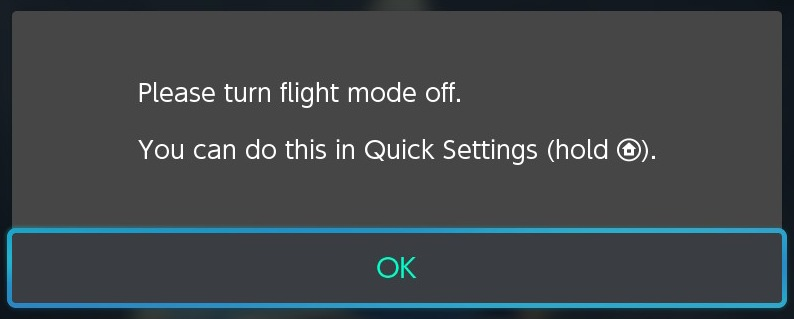
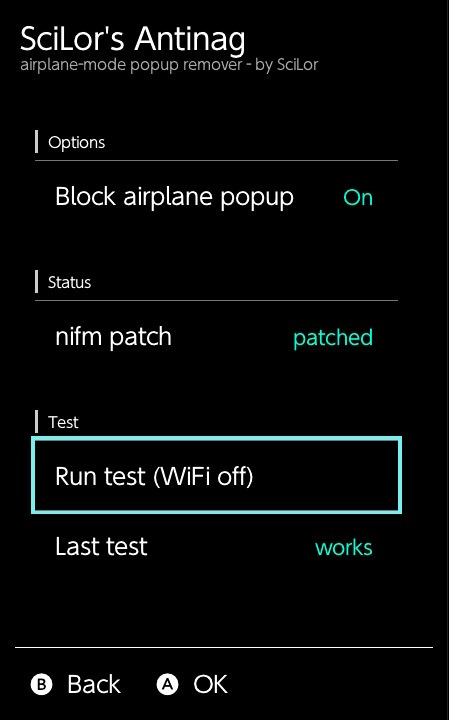

<p align="center"></p>

# SciLor's Antinag

Removes the **"Please turn flight mode off."** popup that some games show over and over while your Nintendo Switch
is in flight mode (airplane mode) — for example when you play offline on purpose.

Only that one popup is blocked. Every other network or error dialog still works as usual.

<p align="center">
  
  &nbsp;&nbsp;
  
</p>

## Features

* Blocks the airplane-mode popup in every game, no per-game setup
* Nothing on your system partition is modified — the patch lives in memory only and is gone after a reboot or when you switch it off
* Switch it on and off live from the Tesla / Ultrahand overlay, no reboot
* Built-in **self-test** in the overlay to check that the patch works on your console
* Works across firmware versions (checked against 17.0.1 – 23.5.0), and does nothing if a future firmware does not match

## Requirements

* A Switch running **Atmosphere** custom firmware
* For the overlay: [Ultrahand](https://github.com/ppkantorski/Ultrahand-Overlay) or [Tesla-Menu](https://github.com/WerWolv/Tesla-Menu) with `nx-ovlloader`
  (the overlay is optional — the patch also works without it)

Tested on firmware **23.0.1** with Atmosphere **1.12.1**.

## Installation

1. Download the latest `sys-antinag.zip` from the [Releases](../../releases) page.
2. Extract the zip into the **root of your SD card**, merging folders when asked. It adds:
   ```
   atmosphere/contents/420000BADBEE0000/   the sysmodule
   switch/.overlays/sys-antinag.ovl        the overlay (optional)
   ```
3. **Reboot** the console. The sysmodule starts by itself.
4. Open your overlay menu and start **SciLor's Antinag**. The status line should say `patched`.

### Check that it works

1. Switch on flight mode and turn **WiFi off** (WiFi stays off, flight mode stays on).
2. In the overlay choose **Run test (WiFi off)**. The result row shows **works** when the popup is suppressed.
3. Start the game that showed the popup — it should stay away now.

### Update / uninstall

* **Update:** extract the new zip over the old files and reboot.
* **Uninstall:** delete `atmosphere/contents/420000BADBEE0000/`, `switch/.overlays/sys-antinag.ovl` and `config/sys-antinag/`, then reboot.
* **Switch it off temporarily:** turn off *Block airplane popup* in the overlay (nifm is restored immediately).

## Configuration

`/config/sys-antinag/config.ini` — normally you only use the overlay, but you can edit it by hand:

```ini
[antinag]
enabled=1       ; 1 = block the popup, 0 = off (applied within a second, no reboot)
debug=0         ; 1 = developer file triggers (see "For developers")
show_debug=0    ; 1 = show the Developer section in the overlay
```

Status of the sysmodule: `/config/sys-antinag/status.txt` — log: `/config/sys-antinag/log.txt`.

### Status values

| `state=` | meaning |
| --- | --- |
| `patched` | the popup is blocked |
| `original` | switched off, nifm is untouched |
| `unsupported` | this firmware's nifm does not match; nothing was changed (please report your firmware version) |
| `nifm_missing` | nifm is not running (yet) |
| `no_cave` / `error_*` | the patch could not be applied; see `log.txt` |

## Troubleshooting

* **Overlay says "sysmodule not running"** — reboot once after the first install; check that `atmosphere/contents/420000BADBEE0000/flags/boot2.flag` exists.
* **Test says "turn WiFi off"** — the popup only exists while the console cannot connect. Turn WiFi off in flight mode and run it again.
* **Status `unsupported`** — your firmware changed nifm. Open an issue with your firmware version and `log.txt`.
* **Other mods that touch nifm** — only one patch can own that function; disable the other one.

## How it works

*Coming soon.*

## For developers

### Build

```
export DEVKITPRO=/opt/devkitpro     # devkitPro with libnx 4.12 or newer
make            # sysmodule + overlay -> out/  (copy out/* to the SD card)
make test       # unit test of the patch logic; make test IMGS="path/to/nifm/img.bin ..." also checks real nifm binaries
```

`img.bin` is the decompressed nifm `main` without its 0x100-byte NSO header.

### Debug mode — peek and poke over WiFi

Set `show_debug=1` in the config to see the toggle in the overlay (or set `debug=1` directly). Then drop a file into
`/config/sys-antinag/debug/` (for example with an FTP app on the console) and read the answer in `log.txt`.
Offsets are relative to the start of nifm's `.text`.

| file | content | action |
| --- | --- | --- |
| `peek.txt` | lines `<hexoff> <len>` | logs the bytes |
| `poke.txt` | lines `<hexoff> <hexbytes>` | writes the bytes into nifm (live; a nifm restart or reboot undoes it) |
| `dump` | empty file | writes nifm's heap/data/stack to `debug/dump_*.bin` |
| `probe` / `probe_auto` | empty file | one (or a repeated) real nifm request incl. `GetAppletInfo`, result in the log |

Debug mode lets the module read and write another process's memory on request — keep it off in normal use.

## Ideas

* After N consecutive airplane-mode requests let the popup through again, as protection against a game that loops on the error.
* A table of "suppress popup X" entries / user-provided patch files for other nag screens.
* Build the overlay with [libultrahand](https://github.com/ppkantorski/libultrahand) (touch support, themes).
* A readable report when a firmware does not match.

## Release and store packaging

* Pushing a tag `vX.Y.Z` makes GitHub Actions build and publish `sys-antinag.zip`; the matching section of [CHANGELOG.md](CHANGELOG.md) becomes the release notes.
* `hbas/sys-antinag/` holds the package description (`pkgbuild.json`, icon, banner) for the
  [Homebrew App Store](https://hb-app.store/submit-or-request). Update `version`, `changelog` and the zip URL there for each release,
  then open a pull request against [switch-hbas-repo](https://github.com/fortheusers/switch-hbas-repo) or use the form at submit.fortheusers.org.
* `docs/icon.svg` is the editable icon (`rsvg-convert -w 256 -h 256 docs/icon.svg -o docs/icon.png`).

## License

GPL-2.0-only — see [LICENSE](LICENSE). The overlay builds on libtesla / libultrahand, which are GPLv2 as well.

## Credits

Built with [libnx](https://github.com/switchbrew/libnx), [libtesla](https://github.com/WerWolv/libtesla) and the
[Atmosphère](https://github.com/Atmosphere-NX/Atmosphere) custom firmware. Overlay by **SciLor**.
